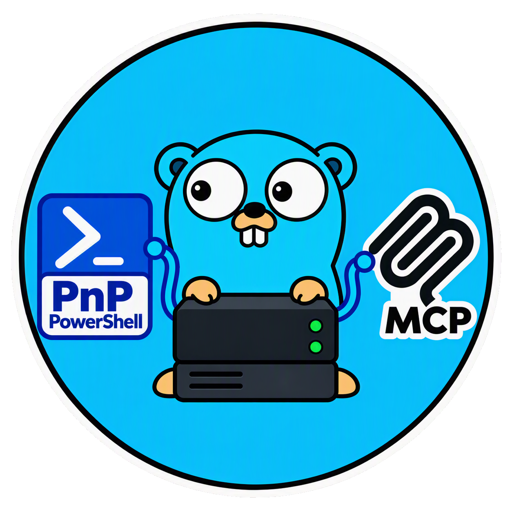

# PnP.PowerShell MCP Server

<div align="center">
  
</div>

</br>
</br>

An [MCP](https://modelcontextprotocol.io) server that lets AI assistants
run [PnP.PowerShell](https://pnp.github.io/powershell/) cmdlets against
SharePoint and Microsoft 365.

- **Always current:** the cmdlet list is read from the installed module and
  refreshed when the module changes.
- **Docs-first:** current documentation is one tool call away, and unchecked
  cmdlets are flagged.
- **Validated:** PnP cmdlet and parameter names are checked before anything runs.
- **Readable errors:** connection, sign-in and permission problems come back with
  clear next steps.

See [best-practices.md](best-practices.md) for usage guidance.

## Prerequisites

To use the server:

- PowerShell 7+ (`pwsh`) in PATH
- `Install-Module PnP.PowerShell -Scope CurrentUser`
- An Entra ID app registration: https://pnp.github.io/powershell/articles/registerapplication.html

To build from source, additionally: Go (see `go.mod`).

## Install

```sh
git clone https://github.com/14096/pnp-powershell-mcp-server.git
cd pnp-powershell-mcp-server
make build        # -> bin/pnp-powershell-mcp-server
```

Or install straight from GitHub with Go (the binary lands in `$(go env GOPATH)/bin`):

```sh
go install github.com/14096/pnp-powershell-mcp-server@latest
```

Or download a prebuilt binary (Linux, macOS, Windows; amd64/arm64) from the
[Releases](https://github.com/14096/pnp-powershell-mcp-server/releases) page and
verify it against `checksums.txt`.

Use the **absolute path** to the binary in the client configs below
(`/path/to/pnp-powershell-mcp-server/bin/pnp-powershell-mcp-server`). On
Windows build with `go build -o bin/pnp-powershell-mcp-server.exe .` and use the
`.exe` path.

## Client setup

The server speaks MCP over **stdio**, so every client just needs the command to
start it. Restart the client after editing its config.

### OpenCode

`opencode.json` (project) or `~/.config/opencode/opencode.json` (global):

```json
{
  "$schema": "https://opencode.ai/config.json",
  "mcp": {
    "pnp-powershell": {
      "type": "local",
      "command": [
        "/path/to/pnp-powershell-mcp-server/bin/pnp-powershell-mcp-server"
      ],
      "enabled": true
    }
  }
}
```

### Claude Code

```sh
claude mcp add pnp-powershell -- /path/to/pnp-powershell-mcp-server/bin/pnp-powershell-mcp-server
# or share with the team through the repo's .mcp.json:
claude mcp add --scope project pnp-powershell -- /path/to/pnp-powershell-mcp-server/bin/pnp-powershell-mcp-server
```

Check with `claude mcp list` or `/mcp` inside Claude Code.

### Cursor

`~/.cursor/mcp.json` (global) or `.cursor/mcp.json` (project):

```json
{
  "mcpServers": {
    "pnp-powershell": {
      "command": "/path/to/pnp-powershell-mcp-server/bin/pnp-powershell-mcp-server"
    }
  }
}
```

Enable it under _Settings -> MCP_.

### VS Code (GitHub Copilot Chat)

`.vscode/mcp.json` in the workspace (or run _MCP: Open User Configuration_):

```json
{
  "servers": {
    "pnp-powershell": {
      "type": "stdio",
      "command": "/path/to/pnp-powershell-mcp-server/bin/pnp-powershell-mcp-server"
    }
  }
}
```

Open Copilot Chat in **Agent** mode and enable the server's tools in the tools picker.

### GitHub Copilot CLI

`~/.copilot/mcp-config.json` (or use `/mcp add` inside the CLI):

```json
{
  "mcpServers": {
    "pnp-powershell": {
      "type": "local",
      "command": "/path/to/pnp-powershell-mcp-server/bin/pnp-powershell-mcp-server",
      "args": [],
      "tools": ["*"]
    }
  }
}
```

Config locations and field names change between client versions; if something
doesn't match, check the client's MCP documentation.

### First use

1. Connect once in a separate PowerShell 7 session (the token cache is reused):
   `Connect-PnPOnline -Url "https://<tenant>.sharepoint.com" -Interactive -ClientId "<app-id>"`
2. Ask the assistant something like "list the lists on my site". It will use
   `pnpSearchCmdlets` -> `pnpGetCmdletDocs` -> `pnpRunCmdlet`.

## Local development

```sh
make build     # compile to bin/
make test      # unit tests (integration tests skip without pwsh + PnP.PowerShell)
make vet fmt   # static checks / formatting
```

**Point a client at your working copy.** Use the `bin/` binary in the client
config, run `make build` after each change, then restart or reload the MCP
server in the client. To skip the manual build, run from source instead:

```json
{
  "command": "sh",
  "args": ["-c", "cd /path/to/pnp-powershell-mcp-server && exec go run ."]
}
```

(In OpenCode: `"command": ["sh", "-c", "cd /path/... && exec go run ."]`.)

**Try tools without an AI client** using the MCP Inspector:

```sh
npx @modelcontextprotocol/inspector ./bin/pnp-powershell-mcp-server
```

**Debugging tips**

- Logs go to **stderr**; stdout is reserved for the MCP protocol, so never
  print to stdout in server code.
- The catalog cache is `~/.cache/pnp-powershell-mcp-server/catalog.json`;
  delete it to force a rebuild.
- PowerShell scripts live in `internal/pwsh/scripts/*.ps1` and are embedded at
  build time, so rebuild after editing them.

## Tools

| Tool                | Purpose                                                                                              |
| ------------------- | ---------------------------------------------------------------------------------------------------- |
| `pnpSearchCmdlets`  | Keyword search over installed cmdlets                                                                |
| `pnpGetCmdletDocs`  | Current docs for a cmdlet (online, falls back to local `Get-Help`)                                   |
| `pnpRunCmdlet`      | Run an expression in a fresh `pwsh`; names are validated and risky operations need your confirmation |
| `pnpRefreshCmdlets` | Rebuild the catalog; `update: true` installs the latest module first                                 |
| `pnpGetModuleInfo`  | Installed version, catalog status                                                                    |

Recommended flow: search -> docs -> run.

Every tool also returns **structured content** with a published output schema,
next to the text block (which is unchanged). Each result has an `ok` flag (`false`
on errors). Highlights: `pnpSearchCmdlets` returns `results[{name, synopsis}]`;
`pnpRunCmdlet` returns `output`, the parsed JSON in `data` when the output is
complete valid JSON, plus `truncated`, `confirmationRequired`, `confirmationToken`,
`cancelled` and `undocumentedCmdlets`; `pnpGetCmdletDocs` returns `markdown`,
`source` and `moduleVersion`; `pnpGetModuleInfo` and `pnpRefreshCmdlets` return
versions and counts.

`pnpRunCmdlet` runs each expression in a fresh `pwsh` process with
`$ErrorActionPreference = 'Stop'`. Before executing, it parses the expression and
rejects unknown `*-PnP*` cmdlets and parameters. The expression is passed via an
environment variable, never interpolated into a script. If a cmdlet's docs were
not fetched in the session, the result carries a note.

## Security and confirmation of risky operations

`pnpRunCmdlet` executes PowerShell with your user's privileges and the
permissions of your `Connect-PnPOnline` session. Before running anything, the
expression is analysed and **risky operations require your confirmation**. No
configuration or environment variable is needed; the confirmation happens in the
conversation.

What counts as risky:

- Destructive verbs: `Remove-*`, `Clear-*`, `Reset-*`, `Revoke-*`, `Unpublish-*`,
  `Uninstall-*`, `Unregister-*`, `Disable-*`, `Deny-*`, `Stop-*`, `Restart-*`, `Format-*`
  (aliases like `rm`/`del` are resolved)
- Write calls through `Invoke-PnPSPRestMethod` / `Invoke-PnPGraphMethod`
  (any `-Method` other than `Get`) and `Invoke-PnPBatch`
- Method calls such as `.Delete()`, `.DeleteObject()`, `.Recycle()`
- Arbitrary code or side effects: `Invoke-Expression`, `Invoke-Command`,
  `Start-Process`, `Invoke-WebRequest`, `Invoke-RestMethod`, file writes,
  external programs, and dynamic invocation like `& $cmd`

How confirmation works:

1. The call returns without executing anything and lists exactly what would happen.
2. **Default - confirmation in the conversation (works in every client):** the
   assistant is told to show you the operations and ask for an explicit yes/no.
   Only after you say yes does it retry with a single-use, 5-minute token bound
   to that exact expression. This relies on the assistant following its
   instructions, so also keep your client's own tool approval enabled for
   `pnpRunCmdlet`.
3. **Optional - native client prompt:** start the server with `--elicitation` and
   clients that support MCP elicitation show a confirmation dialog themselves,
   which the model cannot answer. It is off by default because some clients
   (OpenCode, for example) accept the request but only display the dialog later,
   such as after a restart, which leaves the call stuck. Enable it only for
   clients where it works (add `"--elicitation"` to the command arguments). If a
   prompt goes unanswered for 45 s, the server falls back to the conversation.

Declined requests never reach PowerShell. Read-only expressions run without any prompt.

This is a safety net, not a sandbox: static analysis cannot catch everything
(for example code hidden inside strings or scripts). Also:

- Use an Entra ID app with least-privilege permissions.
- Don't run it against production tenants unattended.

## Output and performance

- **Compact output:** valid JSON (for example from `ConvertTo-Json`) is compacted
  before it is returned, which saves tokens.
- **Size limit:** output over `maxChars` (default 30,000, max 200,000; set per
  call) is truncated with a notice. JSON arrays are cut at item boundaries, so
  the result stays valid JSON, and the notice says how many items were shown
  (`Showing 120 of 4,300 items`) and how to narrow the query (`-First`,
  `-Query`, `Select-Object`). Capture is also capped at 16 MB per command.
- **Docs cache:** documentation pages are cached on disk
  (`~/.cache/pnp-powershell-mcp-server/docs/<module version>/`) for 24 hours and
  re-fetched after a module update. If you are offline, stale cached pages are
  still served.
- **Instant start:** the server answers immediately and loads or rebuilds the
  cmdlet catalog in the background (a first-ever start takes ~4 s to build it;
  tools that need the catalog wait for it).
- **Fresh process per call:** each call starts a new `pwsh` (about 0.8 s
  including the module import). This is deliberate: no state leaks between calls
  and a hung command can be killed cleanly, so a persistent session is not used.

## Authentication

The server does **not** manage authentication. Run `Connect-PnPOnline` yourself
in a PowerShell 7 session; the token cache is reused by every `pwsh` the server
spawns:

```powershell
Connect-PnPOnline -Url "https://<tenant>.sharepoint.com" -Interactive -ClientId "<app-id>"
```

See [best-practices.md](best-practices.md) for device login, certificate and
managed identity options. Never put credentials in expressions.

## Error messages

Common failures are translated into short, actionable messages:

| Situation                                | Message                                            |
| ---------------------------------------- | -------------------------------------------------- |
| Not signed in                            | "Not connected" + how to run `Connect-PnPOnline`   |
| Token expired / re-auth needed           | Asks you to reconnect                              |
| Access denied / missing permission       | Points to required app permissions                 |
| Module missing                           | Shows the `Install-Module` command                 |
| Network problem                          | Suggests checking connection/proxy                 |
| Unknown cmdlet / parameter, syntax error | Names the problem and points to `pnpGetCmdletDocs` |

Anything else is returned with the PowerShell error ID and details.

## Keeping cmdlets up to date

- The catalog is built from `Get-Command -Module PnP.PowerShell` and cached in
  the user cache dir (`~/.cache/pnp-powershell-mcp-server/catalog.json`). It is
  rebuilt when the installed module version changes.
- To pick up a newer module, call `pnpRefreshCmdlets` with `update: true`.
- Unknown-cmdlet errors trigger a background catalog rebuild.
- Docs come from the `dev` branch of the PnP repo, so they may differ slightly
  from the installed version.
